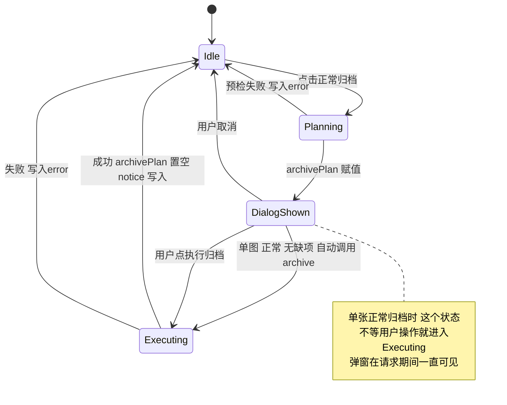
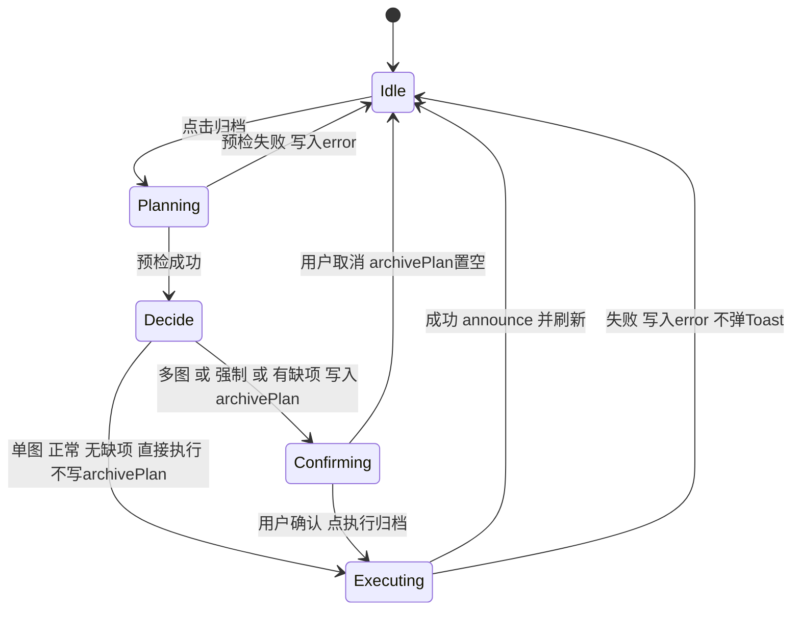
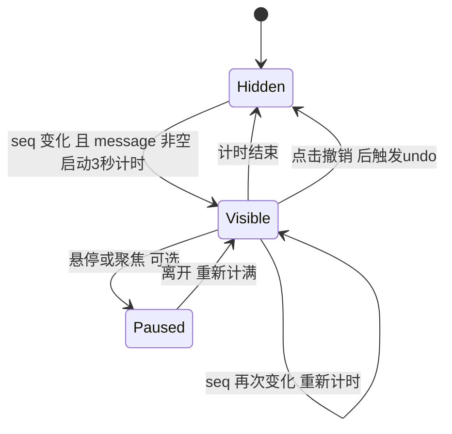

# 前端状态转移设计：归档流程与完成提示

> **状态：设计提案，尚未实现。** 现状部分依据 `frontend/src/stores/review.js`、`App.vue`、`OperationDialogs.vue`、`ReviewScreen.vue` 的源码阅读整理，**没有在浏览器里运行复现**；建议实现前先按 [frontend-debugging.md](frontend-debugging.md) 的断点方法验证第 3 节的结论。
> 视觉与交互见 [frontend-visual-design.md](frontend-visual-design.md)。图使用 Mermaid，GitHub 和 VS Code 的 Markdown 预览可直接渲染。

## 1. 相关状态

均位于 `review` store（Pinia），由 `App.vue`、`ReviewScreen.vue`、`OperationDialogs.vue` 读取。

| 状态 | 类型 | 含义 | 写入者 |
|---|---|---|---|
| `busy` | boolean | 有写操作在进行，所有写入口据此互斥、按钮禁用 | `prepareArchive`、`archive`、`save`、`undo`、`recover` 等 |
| `archivePlan` | object／null | 服务端预检结果（含 `ids`、`force`、`moves`、`errors`、`token`）。**同时承担两个职责**：待执行的计划，以及“归档清单弹窗是否显示” | `prepareArchive` 置位；`archive` 成功、弹窗取消、`close()` 清空 |
| `error` | string | 失败提示，需用户手动收起，不自动消失 | 各操作的 `catch` |
| `notice` | string | 成功类提示，现在只显示在工具栏小字，不会消失 | `archive`、`undo`、`save`、`recover`、`saveBulk`；`start()` 清空 |
| `operations` | object | `can_undo`、未完成的文件操作等，来自 `/api/library` | `refreshOperations` |
| `item` | object／null | 检查页当前图片（含 `state`: `inbox`／`archived`） | `show`、`refreshItem` 等 |

## 2. 归档入口

| 入口 | 位置 | 调用 | 成功后 |
|---|---|---|---|
| 检查页“正常归档／强制归档…” | `ReviewScreen.vue` | `prepareArchive([当前图], force)` | 触发 `changed`，`App` 重新加载列表 |
| 网格“归档所选…／强制归档所选…” | `App.vue` | `prepareArchive(选中的图, force)` | `App` 重新加载列表 |
| 清单弹窗“执行归档” | `OperationDialogs.vue` | `archive(confirmed)` | 触发 `changed`，重新加载列表 |

## 3. 现状：单张正常归档为什么出现“闪现”

对应代码顺序（`prepareArchive` → `archive`）：

1. `archivePlan.value = {...}` 赋值。`OperationDialogs.vue` 用 `v-if="review.archivePlan"` 显示清单，**此时弹窗已满足显示条件**。
2. `finally` 把 `busy` 置回 false，随即因“单图、非强制、无缺项”**自动调用 `archive(false)`**，没有等待用户点击。
3. `archive` 发出归档请求。**弹窗从渲染到请求返回都一直在屏幕上**（请求包含复制、校验，大文件会更久，所以不一定是“一瞬间”）。
4. 请求成功后 `archivePlan = null`，弹窗消失。

副作用（均由 `OperationDialogs.vue` 的 `watch` 引起）：

- 向 `App` 发出 `modal` 事件：`operationModal` 先变 true 再变 false，网格快捷键、预览层随之被挂起，结束后再恢复。
- 弹窗里的“返回／取消”和“执行归档”按钮此时都因 `busy` 被禁用，用户看到的是一个点不了的清单。
- 焦点：`OperationDialogs.vue` 的 `watch` 会在弹窗打开后尝试聚焦第一个可用按钮，关闭时再恢复到原焦点。由于这时按钮已全部禁用，焦点具体落在哪里需要在浏览器里确认（调试方法见 frontend-debugging.md 第 8 节），本文不下结论。

代码里的注释写的是“单图正常归档有配套撤销，无额外弹框”，意图与实现不一致：**把“计划”和“弹窗显示”绑在同一个变量上，是根因。**

另有一处相关的小风险：`archive` 成功后还会 `await refreshOperations()`。若此时服务端图库已被切换，该函数会抛错，被 `catch` 捕获并写入 `error`、返回 false，而归档本身其实已成功。实现新流程时建议把“归档已成功”和“刷新操作状态失败”分开处理，避免给出矛盾提示。

## 4. 建议的状态转移

核心改动：**把“待确认的清单”和“正在执行的计划”分开**。只有真正需要用户确认时才写入 `archivePlan`；单张正常归档直接执行，不经过弹窗。

| 阶段 | `busy` | `archivePlan` | 界面 |
|---|---|---|---|
| Idle | false | null | 正常 |
| Planning | true | null | 归档按钮禁用 |
| Confirming | false | 有值 | 清单弹窗；有缺项时只能返回，执行按钮禁用 |
| Executing | true | **单图直达路径为 null**；确认路径为有值 | 按钮禁用；确认路径的弹窗仍显示直到结束 |
| 结束（成功） | false | null | 右上角 Toast |
| 结束（失败） | false | null（有缺项时仍保留清单） | 红色提示条，不自动消失 |

实现要点：

- `prepareArchive` 先把预检结果放在局部变量，满足直达条件才调用 `runArchive(plan, false)`，否则赋给 `archivePlan`。
- `archive`（弹窗调用）改为 `runArchive(archivePlan.value, confirmed)`；内部执行逻辑只保留一份。
- 预检返回的 `token` 随执行请求一并提交，协议不变，不修改后端；直达路径还缩短了“预检到执行”的间隔。
- 不改变确认规则：强制归档和多图归档仍必须显示清单并勾选确认（ADR 0007、AGENTS 规则 10）。直达条件必须保持 `ids.length === 1 && !force && !errors.length`，**不能放宽**。

## 5. Toast 自身的状态

规则：

- 组件只监听 `seq`，**不监听 `message` 文字**，所以相同文字再次出现也会重新显示。
- `review.start()` 清空 `notice` 不会让正在显示的提示消失；提示是否可见由组件的 `visible` 自己决定。
- 存在 `review.error` 时，成功 Toast 不应掩盖它；两者位置不同（提示条在工具栏下方，Toast 在右上角），可同时存在。
- Toast 挂在 `App.vue`，网格和检查页两种界面都生效。

## 6. 各操作的提示归属

| 操作 | 成功 | 失败 |
|---|---|---|
| 归档（单张／多张／强制） | Toast：`已归档 N 张`，带撤销 | `error` 提示条 |
| 撤销 | Toast：`已撤销最近一次操作` | `error` |
| 保存资料 | Toast（有错误行时仍保留在草稿，并提示错误行） | `error` |
| 多选追加来源 | Toast；有坏行时弹窗保留坏行文本 | `error` |
| 文件恢复 | Toast | `error` |
| 草稿同步 | 保持检查页内 `draft-status` | 同左 |

“保存资料”有一个特殊情况：有效内容已保存但仍有错误行时，`notice` 现在写的是“有效内容已保存；错误行仍留在草稿”。这条带有需要用户处理的信息，**迁移时应保留在检查页内可见，不宜只放进 3 秒 Toast**，具体取舍待确认。

## 7. 并发与竞态约束

- `busy` 是写操作的互斥闸：所有写入口开头检查，归档期间 `close()`、切图（`show`）都会被拒绝。新流程必须保留。
- 现有代码中，`prepareArchive` 的 `finally` 把 `busy` 置回 false 后，同步调用 `archive`，后者在第一个 `await` 之前又把 `busy` 置为 true，所以目前没有其他写入口能插入的间隙。新流程改写时要保持这一点：要么在一次 `busy = true` 内连续完成预检和执行，要么保证“置 false → 再置 true”之间没有 `await`。
- `show()` 使用 `generation` 丢弃过期响应；归档完成后的 `refreshItem()` 仅在当前图片属于 `plan.ids` 时执行。
- 写请求带 `X-Gallery-Library`，图库在服务重启后变化时后端拒绝写入；前端 `refreshOperations` 检测到图库标识变化会清空会话，这一逻辑不属于本次改动。

## 8. 测试矩阵（实现时）

现有测试 `frontend/tests/review-store.test.js` 的“单图正常归档直接执行，强制或多图必须停在清单”只断言了单图会调用一次 `executeArchive`、多图会停在清单；**没有断言执行过程中 `archivePlan` 是否出现过**，所以它在当前“先弹窗再自动执行”的实现下也能通过，不能证明弹窗不闪现。实现时需要补一条：在 `executeArchive` 的 mock 里（请求进行中）读取 `review.archivePlan`，断言为 null。

| 场景 | 期望 |
|---|---|
| 单张、正常、无缺项 | 全程 `archivePlan` 为 null；成功后 `announce` 一次；不出现清单 |
| 单张、预检有缺项 | `archivePlan` 有值并带 `errors`；不自动执行 |
| 单张、强制 | 显示清单并要求勾选确认 |
| 多张、正常 | 显示清单并要求勾选确认 |
| 预检请求失败 | `error` 写入；无清单；无 Toast |
| 执行请求失败 | `error` 写入；`archivePlan` 状态与错误种类一致；无成功 Toast |
| 执行成功后 `refreshOperations` 失败 | 归档已成功的事实不被覆盖为“失败” |
| 归档期间再次点击归档／关闭检查页 | 被 `busy` 拦住 |
| 连续两次成功归档 | 第二次重新计时，旧计时器被清除 |
| Toast 显示期间点击顶栏按钮 | 按钮可正常响应 |
