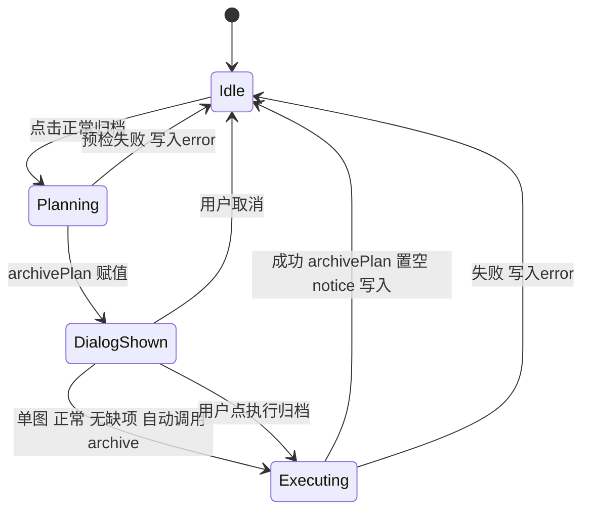
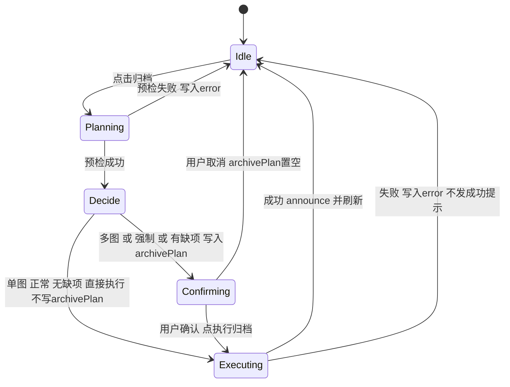
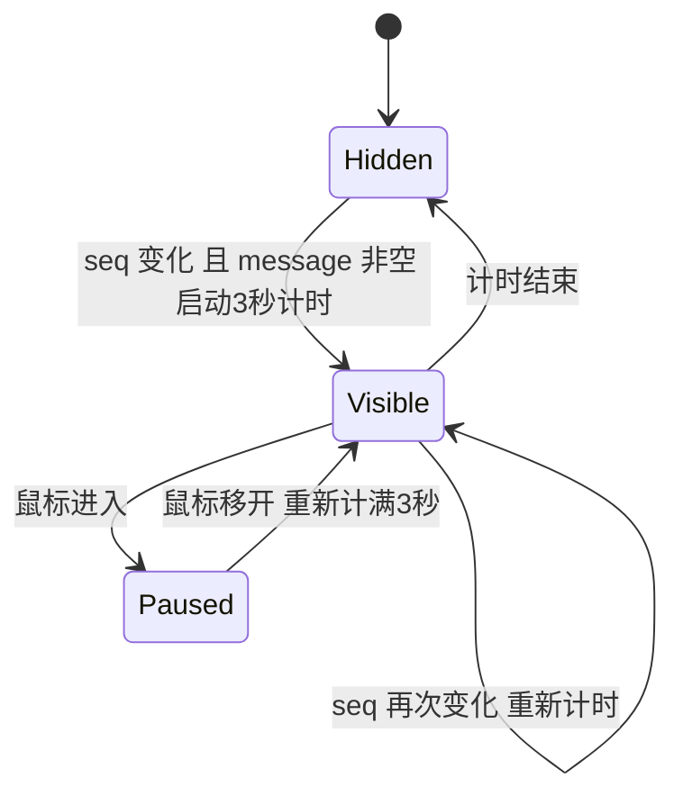

# 前端状态转移设计：归档流程与完成提示

> **状态：已在 `feat/archive-toast` 实现，设计待红豆确认。** 第 3 节记录改动前的流程和原因，第 4 节是现在的实现；依据 `frontend/src/stores/review.js`、`App.vue`、`OperationDialogs.vue`、`ReviewScreen.vue`、`ToastNotice.vue` 及 `frontend/tests/review-store.test.js`、`toast-notice.test.js` 整理。**改动前的流程是读源码得出的，没有在浏览器里运行复现**；现在的实现有 store 单元测试覆盖，但界面层的表现（弹窗是否确实不再出现）也没有在真实浏览器里目测，调试方法见 [frontend-debugging.md](frontend-debugging.md)。
> 视觉与交互见 [frontend-visual-design.md](frontend-visual-design.md)。图使用 Mermaid，GitHub 和 VS Code 的 Markdown 预览可直接渲染。

## 1. 相关状态

均位于 `review` store（Pinia），由 `App.vue`、`ReviewScreen.vue`、`OperationDialogs.vue`、`ToastNotice.vue` 读取。

| 状态 | 类型 | 含义 | 写入者 |
|---|---|---|---|
| `busy` | boolean | 有写操作在进行，所有写入口据此互斥、按钮禁用 | `prepareArchive`、`runArchive`、`save`、`undo`、`recover` 等 |
| `archivePlan` | object／null | 服务端预检结果（含 `ids`、`force`、`moves`、`errors`、`token`）。**现在只表示“等待用户确认的清单”**：有值才显示清单弹窗 | `prepareArchive` 在需要确认时置位；`runArchive` 成功、弹窗取消、`close()` 清空 |
| `error` | string | 失败提示，需用户手动收起，不自动消失 | 各操作的 `catch` |
| `notice` | string | 最近一条成功提示的文字 | `announce`；`start()` 会清空文字，但不会让已显示的提示消失 |
| `noticeSeq` | number | 提示序号，每次 `announce` 加一；`ToastNotice` 只监听它 | `announce` |
| `operations` | object | `can_undo`、未完成的文件操作等，来自 `/api/library` | `refreshOperations` |
| `item` | object／null | 检查页当前图片（含 `state`: `inbox`／`archived`） | `show`、`refreshItem` 等 |

## 2. 归档入口

| 入口 | 位置 | 调用 | 成功后 |
|---|---|---|---|
| 检查页“正常归档／强制归档…” | `ReviewScreen.vue` | `prepareArchive([当前图], force)` | 返回 true 时触发 `changed`，`App` 重新加载列表 |
| 网格“归档所选…／强制归档所选…” | `App.vue` | `prepareArchive(选中的图, force)` | 返回 true 时 `App` 重新加载列表 |
| 清单弹窗“执行归档” | `OperationDialogs.vue` | `archive(confirmed)` → `runArchive(archivePlan.value, confirmed)` | 返回 true 时触发 `changed`，重新加载列表 |

## 3. 改动前：单张正常归档为什么出现“闪现”

> 本节描述的是 T2 基线 `1fa2304` 的流程，**现在已不是这样**，保留用于说明为什么要改。

对应当时的代码顺序（`prepareArchive` → `archive`）：

1. `archivePlan.value = {...}` 赋值。`OperationDialogs.vue` 用 `v-if="review.archivePlan"` 显示清单，此时弹窗已满足显示条件。
2. `finally` 把 `busy` 置回 false，随即因“单图、非强制、无缺项”自动调用 `archive(false)`，没有等待用户点击。
3. `archive` 发出归档请求。弹窗从渲染到请求返回都在屏幕上（请求包含复制、校验，大文件会更久，所以不一定是“一瞬间”）。
4. 请求成功后 `archivePlan = null`，弹窗消失。

当时的副作用（由 `OperationDialogs.vue` 的 `watch` 引起）：

- 向 `App` 发出 `modal` 事件：`operationModal` 先变 true 再变 false，网格快捷键、预览层随之被挂起，结束后再恢复。
- 弹窗里的“返回／取消”和“执行归档”按钮此时都因 `busy` 被禁用，用户看到的是一个点不了的清单。
- 焦点：弹窗打开后会尝试聚焦第一个可用按钮，关闭时恢复到原焦点。由于按钮已全部禁用，焦点具体落在哪里没有在浏览器里确认，本文不下结论。

根因：**把“计划”和“弹窗显示”绑在同一个变量 `archivePlan` 上。**

## 4. 现在的状态转移

核心改动：**只有真正需要用户确认时才写入 `archivePlan`**；单张正常归档把预检结果放在局部变量里，直接执行，不经过弹窗。

| 阶段 | `busy` | `archivePlan` | 界面 |
|---|---|---|---|
| Idle | false | null | 正常 |
| Planning | true | null | 归档按钮禁用 |
| Confirming | false | 有值 | 清单弹窗；有缺项时只能返回，执行按钮禁用 |
| Executing | true | 直达路径为 null；确认路径为有值 | 按钮禁用；确认路径的弹窗仍显示直到结束 |
| 结束（成功） | false | null | 右上角提示 |
| 结束（失败） | false | 直达路径为 null；确认路径保留清单（`archivePlan` 只在成功时清空） | 提示条，不自动消失 |

实现要点（对应 `prepareArchive` / `archive` / `runArchive`）：

- `prepareArchive` 先把预检结果放在局部变量 `plan`，满足 `ids.length === 1 && !force && !plan.errors.length` 才调用 `runArchive(plan, false)`，否则赋给 `archivePlan` 并返回 false。
- `archive`（弹窗调用）只是 `runArchive(archivePlan.value, confirmed)`；执行逻辑只保留一份。
- 预检返回的 `token` 仍随执行请求一并提交，协议不变，后端未修改。
- **不改变确认规则**：强制归档和多图归档仍必须显示清单并勾选确认（ADR 0007、AGENTS 规则 10）。直达条件不能放宽。
- 返回值：`prepareArchive` 在直达路径返回 `runArchive` 的结果；需要清单时返回 false，调用方据此不刷新列表。

## 5. 提示框自身的状态

规则（均以 `ToastNotice.vue` 为准）：

- 组件只监听 `seq`，**不监听 `message` 文字**，所以相同文字再次出现也会重新显示。`message` 为空时隐藏。
- 没有“点击撤销”这一迁移：**提示里没有撤销按钮**（见 frontend-visual-design.md 第 3 节）。
- 窄屏（宽度 ≤ 520px）和无悬停设备（触屏）下提示框 `pointer-events: none`，不会产生 `Paused`；这时只靠 3 秒计时消失。
- `review.start()` 清空 `notice` 文字不会让正在显示的提示消失；可见性由组件自己的 `visible` 决定。
- 存在 `review.error` 时，成功提示不会掩盖它；两者位置不同（提示条在工具栏下方，提示框在右上角），可同时存在。
- 提示框挂在 `App.vue`，网格和检查页都生效。

## 6. 各操作的提示归属

| 操作 | 成功 | 失败 |
|---|---|---|
| 归档（单张／多张／强制） | `announce`：`已归档 N 张；来源核查状态保持不变` | `error` 提示条 |
| 撤销 | `announce`：`已撤销最近一次操作；草稿未视为正式资料` | `error` |
| 保存资料 | `announce`：`资料已保存，未自动归档`；有错误行时为 `有效内容已保存；错误行仍留在草稿，请纠正后继续` | `error` |
| 多选追加来源 | `announce`；有坏行时弹窗保留坏行文本 | `error` |
| 文件恢复 | `announce`：`文件操作已完成`／`已恢复操作前状态` | `error` |
| 草稿同步 | 保持检查页内 `draft-status`，不走提示框 | 同左 |

“保存资料”有错误行时，说明文字也是 3 秒后消失；错误行本身仍留在草稿和 `lines` 中并在检查页显示，所以信息没有丢。是否改为常驻见 frontend-visual-design.md 第 7 节。

## 7. 并发与竞态约束

- `busy` 是写操作的互斥闸：所有写入口开头检查，归档期间 `close()`、切图（`show`）都会被拒绝。
- `prepareArchive` 在 `finally` 把 `busy` 置回 false，然后**同步**调用 `runArchive`，后者在第一个 `await` 之前重新置为 true，所以没有其他写入口能插入的间隙。要保持这一点：这两步之间不能加入 `await`。
- `show()` 使用 `generation` 丢弃过期响应；归档完成后的 `refreshItem()` 仅在当前图片属于 `plan.ids` 时执行。
- 写请求带 `X-Gallery-Library`，图库变化时后端拒绝写入；前端 `refreshOperations` 检测到图库标识变化会清空会话，这一逻辑不属于本次改动。

## 8. 已知遗留问题

**归档成功后刷新失败，会同时出现成功提示和错误条，且列表不刷新。** `runArchive` 在 `executeArchive` 成功后依次执行：清空 `archivePlan`、`announce`、`await refreshOperations()`、必要时 `await refreshItem()`。后两步若抛错（例如 `refreshOperations` 发现服务已切换到另一图库而抛出），会进入 `catch`：写入 `error`、返回 false。结果是：

- 归档已经完成，提示框已发出“已归档”；
- 同时出现错误条；
- 调用方因返回 false 不会重新加载列表，界面上的图片状态可能没有更新。

这个行为在改动前就存在，本次实现没有改变它（只是成功提示由工具栏小字换成了提示框，两条信息矛盾更显眼）。修复需要把“归档已成功”和“事后刷新失败”分开处理，**属于状态逻辑改动，待红豆确认后另行处理**，此处不擅自改动。

## 9. 测试覆盖

已有自动化测试（`frontend/tests/review-store.test.js`、`toast-notice.test.js`）：

| 场景 | 期望 | 覆盖 |
|---|---|---|
| 单张、正常、无缺项 | 执行期间和结束后 `archivePlan` 均为 null；`noticeSeq` 加一；文字含“已归档 1 张” | ✅ 在 `executeArchive` 的 mock 里读取 `archivePlan` |
| 单张、预检有缺项 | `archivePlan` 带 `errors`；不执行；`noticeSeq` 不变 | ✅ |
| 单张、强制 | `archivePlan.force` 为 true；不执行；`noticeSeq` 不变 | ✅ |
| 多张、正常 | 停在清单，不执行 | ✅（既有测试“单图正常归档直接执行，强制或多图必须停在清单”） |
| 执行请求失败 | `error` 写入；不发成功提示；`busy` 复位 | ✅ |
| 提示框计时、重新计时、悬停暂停、卸载清理 | 见 frontend-visual-design.md 第 6 节 | ✅ |

**尚无测试覆盖**：

| 场景 | 说明 |
|---|---|
| 预检请求失败 | 期望 `error` 写入、无清单、无成功提示；目前没有专门断言 |
| 归档成功后 `refreshOperations` 失败 | 第 8 节的遗留问题，目前没有测试，也没有修复 |
| 归档期间再次点击归档／关闭检查页被 `busy` 拦住 | 靠代码里的开头检查，没有专门断言 |
| 提示显示期间顶栏按钮仍可点击 | 需要真实浏览器验证 |
